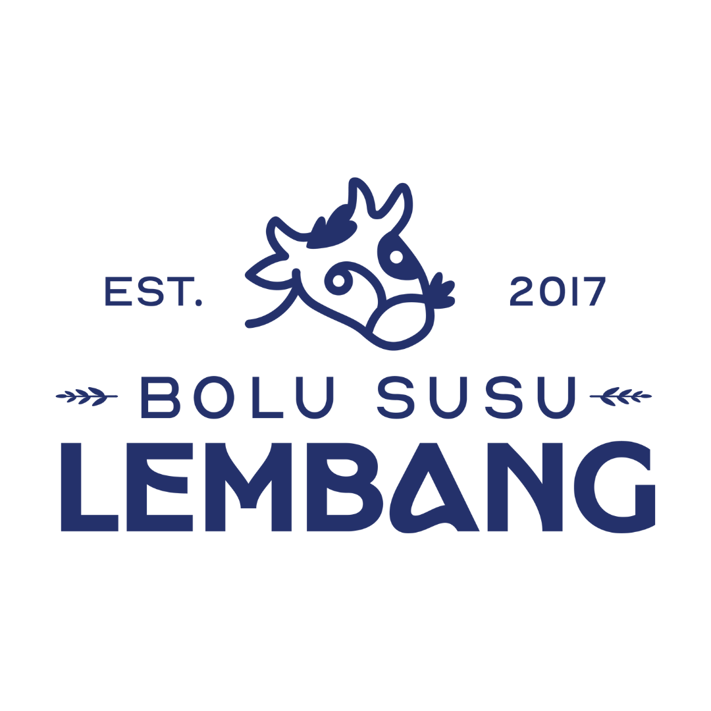

# TUGAS-HAKI-LICENSE-LAYSA

  <h3>A. Identitas Produk Perangkat Lunak</h3>
  <ol>
    <li>
      <strong>Nama Aplikasi / Software:</strong> Pencatatan Stok Barang BSL (Bolu Susu Lembang/Mobile)
    </li>
    <li>
      <strong>Kategori Produk:</strong> Aplikasi pencatatan Stok barang berbasis Android
    </li>
    <li>
      <strong>Deskripsi Singkat Fungsi Aplikasi:</strong> 
      Pencatatan Stok Barang BSL adalah aplikasi pencatatan stok digital seluler yang dirancang untuk membantu proses pencatatan dan pengelolaan stok barang menggunakan barcode agar data barang lebih mudah dicatat, diperbarui, dan dipantau, sekaligus meminimalisir kesalahan manusia (human error).
    </li>
  </ol>

  <h3>B. Analisis Perlindungan HAKI Produk</h3>
  <ol>
    <li>
      <strong>Hak Cipta (Copyright):</strong>
      <ol type="a">
        <li>
          <strong>Objek Yang Dilindungi:</strong>
          <ul>
            <li>Kode Sumber (Source Code) Flutter/Dart untuk antarmuka pengguna (frontend) dan MySql (backend).</li>
            <li>Desain Antarmuka (UI/UX Design) yang dibuat menggunakan Canva (file layout, skema warna, dan ikon kustom).</li>
            <li>Dokumen Petunjuk Penggunaan (User Manual) berbentuk PDF untuk pencatatan stok barang.</li>
          </ul>
        </li>
        <li>
          <strong>Pernyataan Hak Cipta:</strong> Hak Cipta © 2026 oleh Laysa Amalia. Seluruh hak dilindungi undang-undang.
        </li>
      </ol>
    </li>
    <li>
      <strong>Merek (Trademark):</strong>
      <ol type="a">
        <li>
          <strong>Nama Brand:</strong> Pencatatan Stok Barang BSL
        </li>
        <li>
          <strong>Logo & Elemen Visual:</strong> Logo monokrom biru tua bergaya vintage-minimalis dengan ikon kepala sapi line-art berlabel 'EST. 2017', berpadu tipografi sans-serif tegas dan ornamen panah.
        </li>
        

          
        

        <li>
          <strong>Fungsi Perlindungan:</strong> Mencegah pengembang lain membuat aplikasi pencatatan stok serupa dengan nama atau logo yang membingungkan konsumen.
        </li>
      </ol>
    </li>
  </ol>

  <h3>C. Pemilihan Lisensi Distribusi</h3>
  <ol>
    <li>
      <strong>Jenis Lisensi Yang Dipilih:</strong> MIT License
    </li>
    <li>
      <strong>Alasan Pemilihan Lisensi:</strong> 
      Saya memilih MIT License karena ingin aplikasi Pencatatan Stok Barang dapat dimanfaatkan secara luas oleh komunitas developer lain untuk dipelajari dan dikembangkan lebih lanjut. Lisensi ini fleksibel namun tetap melindungi nama saya sebagai pembuat asli melalui kewajiban pencantuman atribusi.
    </li>
    <li>
      <strong>Draf Berkas LICENSE (Siap Diunggah ke Repositori / GitHub):</strong>
      
MIT License

      
Copyright (c) 2026 Laysa Amalia

      
Permission is hereby granted, free of charge, to any person obtaining a copy of this software and associated documentation files (the "Software"), to deal in the Software without restriction, including without limitation the rights to use, copy, modify, merge, publish, distribute, sublicense, and/or sell copies of the Software, and to permit persons to whom the Software is furnished to do so, subject to the following conditions:

      
The above copyright notice and this permission notice shall be included in all copies or substantial portions of the Software.

      
THE SOFTWARE IS PROVIDED "AS IS", WITHOUT WARRANTY OF ANY KIND, EXPRESS OR IMPLIED, INCLUDING BUT NOT LIMITED TO THE WARRANTIES OF MERCHANTABILITY, FITNESS FOR A PARTICULAR PURPOSE AND NONINFRINGEMENT. IN NO EVENT SHALL THE AUTHORS OR COPYRIGHT HOLDERS BE LIABLE FOR ANY CLAIM, DAMAGES OR OTHER LIABILITY, WHETHER IN AN ACTION OF CONTRACT, TORT OR OTHERWISE, ARISING FROM, OUT OF OR IN CONNECTION WITH THE SOFTWARE OR THE USE OR OTHER DEALINGS IN THE SOFTWARE.

    </li>
  </ol>
